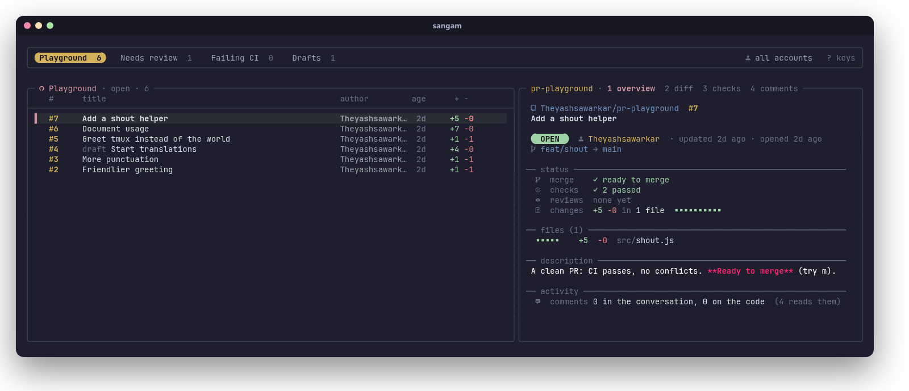
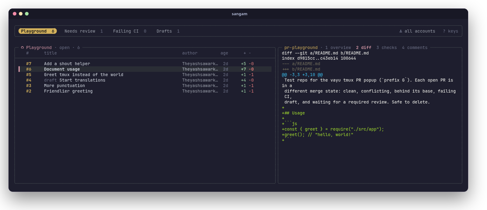
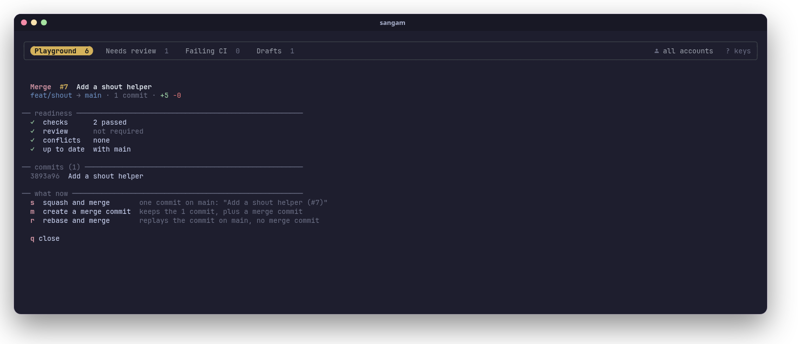

<p align="center">
  <picture>
    <source media="(prefers-color-scheme: dark)" srcset="assets/banner-dark.svg">
    <source media="(prefers-color-scheme: light)" srcset="assets/banner-light.svg">
    
  </picture>
</p>

<p align="center">
  <b>Review and merge GitHub pull requests without leaving the terminal.</b><br>
  Every PR you care about, across repos and accounts, in one keyboard-driven screen.
</p>

<p align="center">
  <a href="https://github.com/Theyashsawarkar/sangam/actions/workflows/ci.yml"></a>
  <a href="https://github.com/Theyashsawarkar/sangam/releases"></a>
  <a href="LICENSE"></a>
  
  
</p>

<p align="center">
  
</p>

> *Sangam* (संगम) is Sanskrit for a confluence: the place where two rivers
> meet and flow on as one. Which is what a merge is.

sangam is a terminal UI for the part of the day spent on pull requests:
finding the ones waiting for you, reading them, reviewing them and merging
them. It runs like lazygit: type `sangam` in any terminal. It's built on
the GitHub CLI (`gh`), fzf and tmux, so it uses your existing `gh` sign-in
and needs no token, server or config to start.

## Contents

- [Features](#features)
- [Install](#install)
  - [Requirements](#requirements)
  - [Quick install](#quick-install)
  - [Other ways to install](#other-ways-to-install)
  - [Update and uninstall](#update-and-uninstall)
- [Getting started](#getting-started)
- [Using sangam](#using-sangam)
  - [The screen](#the-screen)
  - [Sections](#sections)
  - [Accounts](#accounts)
  - [Finding PRs](#finding-prs)
  - [Reading a PR](#reading-a-pr)
  - [Reviewing](#reviewing)
  - [Merging](#merging)
- [Keys](#keys)
- [Command line](#command-line)
- [For AI agents](#for-ai-agents)
- [Using it inside tmux](#using-it-inside-tmux)
- [Colours](#colours)
- [Files and environment](#files-and-environment)
- [How it works](#how-it-works)
- [Troubleshooting](#troubleshooting)
- [Contributing](#contributing)
- [Roadmap](#roadmap)
- [License](#license)

## Features

**See everything that needs you**
- **Sections, like saved searches.** Each section is a GitHub search
  across all your repos: "review requested", "my PRs", one repo, a whole
  org, a label. Switch with `h`/`l`; each tab shows its count.
- **Several GitHub accounts at once.** Run each section as a different
  `gh` account, so work and personal PRs sit side by side. Press `u` to
  focus on one account.
- **The repo you're in comes first.** Start sangam inside a clone and a
  tab for that repo is added automatically.
- **Open, merged, closed or all.** `f` cycles the state for every section;
  `s` narrows a section with any GitHub search (`author:`, `label:`,
  `head:`, words...).

**Read a PR properly**
- **Overview:** state, author, branches, merge readiness, checks, reviews,
  size, labels, assignees, changed files and the description, laid out in
  one screen.
- **Diff** with syntax highlighting (via bat), **checks** with durations,
  and **comments**: the conversation plus review comments on the code,
  grouped by file and line.
- **Failed CI logs, cleaned up.** `Enter` on the checks view opens the
  failed jobs' logs with timestamps stripped and errors highlighted.

**Act on it**
- **A merge panel that knows what the PR needs.** It shows readiness
  (checks, review, conflicts, up to date, draft) and the commits that will
  land, then offers only what makes sense now: the merge methods the repo
  allows, update branch, auto-merge, an admin merge, mark ready, or check
  out to resolve conflicts.
- **Approve, request changes, comment** (in your `$EDITOR`), close or
  reopen, toggle draft, check out the branch, copy the link, open it in
  the browser.

**Fast and out of your way**
- Cached lists show instantly and refresh in the background; the first
  PRs of a section are prefetched, so moving through them is instant.
- Vim-style keys, `?` for a key sheet, `q` to quit.
- Works in any terminal. Inside tmux it can also be a popup on a key
  ([details](#using-it-inside-tmux)).

## Install

### Requirements

sangam is a Bash script. It runs on **Linux** (macOS isn't supported yet:
it uses GNU tools, see the [roadmap](#roadmap)).

| Tool | Version | What for |
|---|---|---|
| [bash](https://www.gnu.org/software/bash/) | 4.4+ | sangam itself |
| [gh](https://cli.github.com) (GitHub CLI) | 2.40+ | everything GitHub: sign-in, search, PR data, merging |
| [fzf](https://github.com/junegunn/fzf) | 0.66+ | the list, preview and key handling |
| [tmux](https://github.com/tmux/tmux) | 3.3+ | the layout (sangam runs its own private tmux server; you don't need to use tmux yourself) |
| [jq](https://jqlang.org) | 1.6+ | reading GitHub's JSON |
| git, less | any | the repo you're in, full-screen views |
| GNU coreutils, GNU grep, util-linux | any | standard on Linux (`md5sum`, `stat`, `grep -P`, `setsid`) |

Optional, but recommended:

| Tool | What you get |
|---|---|
| [bat](https://github.com/sharkdp/bat) | syntax-highlighted diffs and Markdown descriptions |
| A [Nerd Font](https://www.nerdfonts.com) in your terminal | the icons (without one they show as boxes) |
| `notify-send` (libnotify) | desktop notifications after merges, reviews and comments |
| `wl-copy` (Wayland), `xclip` (X11) | `y` copies a PR's link to the clipboard |

Install them with your package manager:

```sh
# Arch Linux
sudo pacman -S --needed github-cli fzf tmux jq git bat libnotify wl-clipboard

# Fedora
sudo dnf install gh fzf tmux jq git bat libnotify wl-clipboard

# Debian / Ubuntu (gh from GitHub's apt repo: https://github.com/cli/cli/blob/trunk/docs/install_linux.md)
sudo apt install gh tmux jq git bat libnotify-bin wl-clipboard
```

> **fzf version:** Debian and Ubuntu ship an fzf older than 0.66. Install
> a current one from [fzf's releases](https://github.com/junegunn/fzf/releases)
> (a single binary: put it in `~/.local/bin`) or with
> `git clone --depth 1 https://github.com/junegunn/fzf ~/.fzf && ~/.fzf/install`.
> On Debian/Ubuntu, bat's command is `batcat`; link it:
> `ln -s /usr/bin/batcat ~/.local/bin/bat`.

`sangam doctor` checks all of this for you.

### Quick install

```sh
curl -fsSL https://raw.githubusercontent.com/Theyashsawarkar/sangam/main/install.sh | bash
```

This clones sangam into `~/.local/share/sangam`, links
`~/.local/bin/sangam` to it, and runs `sangam doctor`. No root needed.
If `~/.local/bin` isn't on your `PATH`, the installer tells you the line
to add.

Installer options (pass them after `bash -s --`):

```sh
curl -fsSL https://raw.githubusercontent.com/Theyashsawarkar/sangam/main/install.sh | bash -s -- --ref v2.0.0   # a specific release
curl -fsSL https://raw.githubusercontent.com/Theyashsawarkar/sangam/main/install.sh | bash -s -- --bin-dir ~/bin
```

| Option | Default | |
|---|---|---|
| `--ref <tag or branch>` | `main` | install a release (e.g. `v2.0.0`) instead of the latest code |
| `--bin-dir <dir>` | `~/.local/bin` | where the `sangam` link goes |
| `--dir <dir>` | `~/.local/share/sangam` | where sangam is cloned |
| `--uninstall` | | remove the link and the clone |

### Other ways to install

**Arch Linux (package):** a PKGBUILD that builds from the latest commit
lives in [`packaging/arch`](packaging/arch/PKGBUILD). It pulls in every
dependency and installs to `/usr`:

```sh
git clone https://github.com/Theyashsawarkar/sangam
cd sangam/packaging/arch
makepkg -si
```

**System-wide with make:**

```sh
git clone https://github.com/Theyashsawarkar/sangam
cd sangam
sudo make install                    # /usr/local/bin/sangam
make install PREFIX=~/.local         # or just for you
```

`make uninstall` (with the same `PREFIX`) removes it again.

**By hand:** sangam is one script. Clone the repo anywhere and link
`bin/sangam` into your `PATH`:

```sh
git clone https://github.com/Theyashsawarkar/sangam ~/src/sangam
ln -s ~/src/sangam/bin/sangam ~/.local/bin/sangam
```

**As a tmux plugin:** see [Using it inside tmux](#using-it-inside-tmux).

### Update and uninstall

| Installed with | Update | Uninstall |
|---|---|---|
| the quick installer | run the install command again | `… install.sh \| bash -s -- --uninstall` |
| the Arch PKGBUILD | `makepkg -si` again in `packaging/arch` (after `git pull`) | `sudo pacman -R sangam-git` |
| `make install` | `git pull && sudo make install` | `sudo make uninstall` |
| TPM (tmux) | `prefix U` | remove the `@plugin` line, then `prefix alt-u` |

Uninstalling leaves your sections (`~/.config/sangam`) and cache
(`~/.cache/sangam`); delete them by hand if you want them gone.

## Getting started

1. **Sign in to GitHub with gh** (once):

   ```sh
   gh auth login
   ```

   To use several accounts (say, work and personal), run `gh auth login`
   once per account. sangam uses all of them.

2. **Check the setup:**

   ```sh
   sangam doctor
   ```

   ```
     sangam 2.0.0

     required
     ✓ bash          5.3.20(1)-release
     ✓ tmux          3.8
     ✓ gh            2.102.0
     ✓ fzf           0.74.5
     ✓ jq            1.8.2
     ✓ git           2.56.0
     ✓ less          710
     ✓ GNU tools     coreutils, grep -P, setsid

     GitHub
     ✓ signed in     work-account, personal-account

     optional
     ✓ bat           highlighted diffs and descriptions
     ✓ notify-send   desktop notifications
     ✓ clipboard     wl-copy
     ! Nerd Font     icons need a Nerd Font in your terminal (can't be checked from here)

     ✓ ready: run sangam
   ```

3. **Run it**, ideally from inside a repo you work on:

   ```sh
   cd ~/code/my-project
   sangam
   ```

   You start in normal mode: `j`/`k` move through PRs, `h`/`l` switch
   sections, `1`–`4` switch what the right side shows, `m` merges, `?`
   shows every key, `q` quits.

On first run sangam creates `~/.config/sangam/sections` with three
sections: **Review requested**, **My PRs** and **Involved**. Make it yours
next: see [Sections](#sections).

## Using sangam

### The screen

```
╭───────────────────────────────────────────────────────────────────────────────╮
│ Review requested 3   My PRs 5   my-project (here) 2      󰀄 all accounts  ? keys │  ← section tabs
╰───────────────────────────────────────────────────────────────────────────────╯
╭─ Review requested · open · 3 ─────────╮╭─ repo · 1 overview 2 diff 3 checks ──╮
│  #     title              author  age ││                                      │
│ ▌#128  Add rate limiting  alice   2h  ││  the selected PR, in the view        │
│  #127  Fix login redirect bob     1d  ││  you picked                          │
╰───────────────────────────────────────╯╰──────────────────────────────────────╯
  the PRs of the current section          overview · diff · checks · comments
```

- **Top:** the sections as tabs, with their PR counts (`·` while
  loading). The current one is highlighted. On the right: the account
  you're focused on (`u`) and any GitHub search (`s`). Long section names
  shrink to their first word when the tabs don't fit.
- **Left:** the PRs of the current section, newest activity first: number,
  title (with a `draft` tag), author, age of the last update and the size
  (`+added −deleted`). In the "all" state, merged and closed PRs are
  tagged too.
- **Right:** the selected PR, in one of four views: `1` overview, `2` diff,
  `3` checks, `4` comments (`Tab` cycles them). `J`/`K` and
  `Ctrl+d`/`Ctrl+u` scroll it; `Enter` opens it full screen.

### Sections

A section is a name, an optional account, and a GitHub search. They live
in `~/.config/sangam/sections`, one per line:

```
# name           | account    | GitHub search
Review requested |            | review-requested:@me
My PRs           |            | author:@me
Involved         |            | involves:@me -author:@me
Work: backend    | work-login | repo:acme/api repo:acme/worker
Dependabot       |            | author:app/dependabot org:acme
```

- **name:** the tab's label.
- **account:** a `gh` account (as `gh auth status` lists it), or empty for
  gh's active account. See [Accounts](#accounts).
- **search:** anything [GitHub's search](https://docs.github.com/en/search-github/searching-on-github/searching-issues-and-pull-requests)
  takes. sangam adds `is:pr`, the state (open/merged/closed) and newest
  first, so leave those out. Several `repo:` filters in one search mean
  *any of these repos*.
- Lines starting with `#` are comments.

Useful searches:

| You want | Search |
|---|---|
| Waiting for your review | `review-requested:@me` |
| Waiting for your team's review | `team-review-requested:acme/backend` |
| Yours | `author:@me` |
| You're mentioned, assigned or commented | `involves:@me` |
| One repo / several | `repo:acme/api` · `repo:acme/api repo:acme/web` |
| A whole org | `org:acme` |
| A label | `org:acme label:bug` |
| Failing CI | `author:@me status:failure` |
| Approved, ready to go | `author:@me review:approved` |
| Drafts | `author:@me draft:true` |
| Bots | `org:acme author:app/dependabot` |
| Busy discussions | `involves:@me comments:>10` |

**Managing sections from inside sangam:** press `S` for a menu to **add**
a section (name, account picked from your signed-in ones, search),
**edit** or **delete** the current one, move it **left** or **right**, or
**pin** the repo you're in as a permanent section. `E` opens the file in
your editor instead. Either way, sangam reloads right after.

**The "here" tab:** started inside a clone of a GitHub repo, sangam adds a
"*repo* (here)" section for it (unless a section already searches exactly
that repo), run as the folder's account (`git config github.user`, see
below). sangam remembers the section you were on last.

**How many PRs:** each section shows up to 50 PRs, newest activity first.
Narrow it with `s` or a more specific search to reach older ones.

### Accounts

sangam works with every account `gh` is signed in to (`gh auth status`):

- A section with an account runs its search as that account. A section
  without one runs as gh's active account, so it follows `gh auth switch`.
- `u` focuses on one account: it cycles **all accounts → each account →
  all**. Focused on one, you see its sections plus the account-less ones
  run as it. The choice is remembered across runs (as long as that account
  is still signed in), and shown at the top right.
- Every action (review, merge, comment...) runs as the account of the
  section you're in.
- The "here" tab uses `git config github.user` of the folder you started
  in. If you keep work and personal code in different folders, set it per
  folder with git's `includeIf`:

  ```ini
  # ~/.gitconfig
  [includeIf "gitdir:~/work/"]
      path = ~/.config/git/work.gitconfig     # contains: [github] user = work-login
  ```

### Finding PRs

- `/` filters the list as you type, fuzzy, over what's on screen (number,
  title, author). `Enter` or `Esc` goes back to normal mode.
- `s` searches GitHub within the current section: anything GitHub search
  takes, such as `author:alice`, `label:bug`, `head:feature/x` or words
  from the title. It's added to the section's own search and shown at the
  top right. An empty search clears it. It lasts until you quit.
- `f` cycles the state for every section: **open → merged → closed →
  all**. `F` jumps between open and all.
- `R` reloads everything from GitHub (sangam also refreshes on its own
  whenever you open it or change section, state, account or search).

### Reading a PR

<p align="center">
  
</p>

- **`1` Overview:** repo, number and title; a state badge (open, draft,
  merged, closed), author, how long ago it was opened and updated, and
  `branch → base` (fork PRs say so). Then **status**: whether it can merge
  and why not (needs review, changes requested, behind, conflicts...),
  checks passed/failed/running, reviews (who approved, who requested
  changes, who's still requested), size with a change bar, labels and
  assignees. Then the **files** with their +/− (long paths shortened in
  the middle), the **description** rendered as Markdown, and a count of
  comments.
- **`2` Diff:** the whole diff, highlighted by bat.
- **`3` Checks:** every check run, failed first, with its workflow and
  duration. `Enter` here opens the **failed jobs' logs**: grouped by job
  and step, timestamps removed, error lines in red.
- **`4` Comments:** the conversation (comments and reviews with a body,
  oldest first) and the review comments on the code, grouped by file and
  line, replies marked.
- **`Enter`** opens the current view full screen in `less` (`q` returns).
- **`b`** opens the PR in your browser; **`y`** copies its link.

### Reviewing

| Key | What happens |
|---|---|
| `a` | **Approve**, with an optional one-line message (`Enter` approves, `Ctrl+c` cancels) |
| `r` | **Request changes**: your `$EDITOR` opens; write the review above the marker line and save. Leave it empty to cancel. |
| `c` | **Comment** on the PR, in your editor the same way |
| `x` | **Close** the PR without merging (asks first, optional closing comment); on a closed PR, **reopen** it |
| `d` | Toggle between **draft** and **ready for review** |
| `o` | **Check out** the PR's branch (`gh pr checkout`): only inside a clone of the PR's repo, asks first |

After each action the PR is re-read from GitHub, and you get a desktop
notification if `notify-send` is installed.

### Merging

<p align="center">
  
</p>

`m` opens the merge panel for the selected PR. It reads the PR and the
repo's merge settings fresh, then shows:

1. **Readiness:** checks, review, conflicts, whether the branch is up to
   date with its base (and whether the repo requires that), and draft.
2. **The commits that will land.**
3. **What you can do now**, and only that:

| Key | Shown when | Does |
|---|---|---|
| `s` | it's ready and the repo allows squash | squash and merge; you can edit the commit title (prefilled `Title (#123)`) |
| `m` | it's ready and the repo allows merge commits | create a merge commit |
| `r` | it's ready and the repo allows rebase | rebase and merge |
| `u` | the base moved on and the repo requires up-to-date branches | update the branch (merges the base in; checks run again) |
| `a` | it's blocked (checks or review pending) and the repo allows auto-merge | enable auto-merge: GitHub squash-merges it once everything passes |
| `!` | it's blocked and you're a repo admin | merge anyway as admin, bypassing branch protection |
| `d` | it's a draft | mark it ready for review |
| `o` | it has conflicts and you're in its clone | check out the branch to resolve them (outside its clone, sangam shows the `gh` command instead) |
| `q` / `Esc` | always | close the panel |

Before merging, sangam asks whether to delete the branch on GitHub
afterwards (unless the repo already does that, or the PR comes from a
fork), then confirms once: `Enter` merges, `Esc` cancels. Your local
checkout is never touched. The panel re-reads the PR after each step, so
"update branch → enable auto-merge" works in one sitting.

## Keys

sangam opens in **normal mode**: letters are commands. `/` switches to
typing a filter; `Enter` or `Esc` switches back.

**Move and find**

| Key | Action |
|---|---|
| `j` / `k` | next / previous PR |
| `g` / `G` | first / last PR |
| `h` / `l` | previous / next section |
| `/` | filter the list |
| `s` | search GitHub within the section |
| `f` | cycle open / merged / closed / all |
| `F` | toggle open ↔ all |
| `u` | switch account |
| `R` | reload from GitHub |
| `S` | add / edit / delete / move sections, pin this repo |
| `E` | edit the sections file |

**Read**

| Key | Action |
|---|---|
| `1` `2` `3` `4` | overview / diff / checks / comments |
| `Tab` | next view |
| `J` / `K` | scroll the preview down / up |
| `Ctrl+d` / `Ctrl+u` | scroll half a page |
| `Enter` | current view full screen (failed logs in checks) |
| `b` | open in the browser |
| `y` | copy the link |

**Act**

| Key | Action |
|---|---|
| `m` | merge panel |
| `a` | approve |
| `r` | request changes |
| `c` | comment |
| `x` | close / reopen |
| `o` | check out the branch (in its clone) |
| `d` | draft ↔ ready for review |
| `?` | show every key |
| `q` / `Esc` | quit |

The merge panel's own keys are listed under [Merging](#merging).

## Command line

```
sangam               open it in this folder (any terminal, in tmux or not)
sangam -C <dir>      open it as if started in <dir>
sangam doctor        check the dependencies and the GitHub sign-in
sangam mcp           an MCP server for AI agents (see For AI agents)
sangam call <tool> [json]   one agent tool, for agents without MCP
sangam --version     print the version
sangam --help        show the help
```

`sangam doctor` exits non-zero when something required is missing, so it
also works in scripts.

## For AI agents

An AI agent (Claude Code, Codex, Aider, anything that speaks MCP or runs a
command) can use your pull requests through sangam: list and search them,
read one with its checks, reviews and comments, read its diff, and comment,
review or merge. **Reading is free; anything that writes to GitHub waits for
your yes.**

Add it to Claude Code (any MCP client works the same way; the server is
`sangam mcp`, on stdio):

```
claude mcp add --scope user sangam -- sangam mcp
```

An agent without MCP runs the same tools as commands:

```
sangam call                                  list the tools
sangam call pr_list '{"section":"Review requested"}'
sangam call pr_view '{"pr":"owner/repo#12"}'
```

| Tool | What it does |
|---|---|
| `pr_accounts` | the signed-in gh accounts, gh's active one, and the one picked in sangam |
| `pr_counts` | how many PRs wait for your review and how many of yours are open (per account) |
| `pr_list` | a GitHub search (`query`), one of your [sections](#sections) (`section`), or every section; `state`, `account`, `limit` |
| `pr_view` | one PR: state, branches, mergeability, reviews, requested reviewers, checks (failing ones with links), files, description, comments, inline review comments |
| `pr_diff` | its diff, or one `file`'s; cut at `max_lines` (2000) |
| `pr_comment` | post a comment: **asks you first** |
| `pr_review` | approve, request changes or comment: **asks you first** |
| `pr_merge` | merge (squash, merge or rebase) or turn on auto-merge, optionally deleting the branch: **asks you first** |

A PR is `owner/repo#number` or its URL. Without `account`, the tools use
the account you picked in sangam with `u` (empty there: all accounts), else
gh's active one; for one PR, the first of those that can see it.

**Approving.** A write opens a popup on your tmux client (the agent's own
pane when it runs in tmux, else the client you used last) showing the PR,
the account it acts as and the text it will post; for a merge, the PR's
checks, review state and mergeability:

| Key | |
|---|---|
| `y` | approve: sangam does it and tells the agent |
| `n` / `Esc` | decline: nothing happens, the agent is told you declined |
| `e` | edit the text in your editor first; the agent is told what was posted |

No answer in 10 minutes is a no. Without tmux, a desktop notification with
Approve / Decline buttons asks instead (no editing); with neither, writes
are refused. Titles, descriptions, comments and diffs are other people's
words, so the tools hand them to the agent inside `<untrusted>` blocks and
the server tells it to treat them as data.

The popup is a consent step, not a sandbox: an agent that can run `gh`
itself can still do so. It's there so an agent that uses sangam never acts
on GitHub without you seeing it first.

## Using it inside tmux

sangam doesn't need tmux to be your terminal setup: it runs its own
private tmux server for its layout, with its own socket and none of your
tmux config. Run it in a tmux pane like any other program.

If you do use tmux, sangam can also be a **popup on a key**: `prefix G`
opens it over whatever you're doing, in the current pane's folder, and
`prefix G` again closes it.

**With [TPM](https://github.com/tmux-plugins/tpm):** add this to your tmux
config, above TPM's `run` line, then press `prefix I`:

```tmux
set -g @plugin 'Theyashsawarkar/sangam'
```

TPM keeps its own copy in `~/.tmux/plugins/sangam`; you don't need the
`sangam` command installed separately for the popup.

**Without TPM:** with sangam cloned somewhere, add:

```tmux
run-shell ~/path/to/sangam/sangam.tmux
```

**Options** (set them before TPM's `run` line):

| Option | Default | |
|---|---|---|
| `@sangam-key` | `G` | key after the prefix that opens the popup (and closes it from inside); `none` binds nothing |
| `@sangam-width` | `90%` | popup width |
| `@sangam-height` | `88%` | popup height |
| `@sangam-title` | ` sangam ` | popup title |
| `@sangam-launcher` | | your own popup command instead of `display-popup`. It's run with display-popup's arguments appended (`-E -d DIR -T TITLE CMD`), tmux formats expanded |

For example, `P` instead of `G`, and a popup helper of your own:

```tmux
set -g @sangam-key 'P'
set -g @sangam-launcher "~/.tmux/scripts/popup.sh '#{client_name}'"
```

## Colours

sangam has its own palette. With [varna](https://github.com/Theyashsawarkar/varna)
(a theme engine) installed, it takes the current theme's colours instead:
it reads `~/.local/state/varna/fzf.sh` at start (the list, borders, badges,
review states, section tabs and the key sheet), so switching the theme
recolours the next sangam you open.

## Files and environment

| Path | What |
|---|---|
| `~/.config/sangam/sections` | your sections ([format](#sections)) |
| `~/.cache/sangam/` | cached lists and PR details (safe to delete), the last section and account |
| `~/.cache/sangam/changed` | the time PRs last changed through sangam (or were reloaded): a status bar can watch it to recount |
| `$XDG_RUNTIME_DIR/sangam-ask.XXXXXX/` | an agent's request while it waits for your approval, removed after |
| `$XDG_RUNTIME_DIR/sangam.XXXXXX/` | one run's state and its private tmux socket, removed on quit |

sangam respects `XDG_CONFIG_HOME` and `XDG_CACHE_HOME`. Other variables:

| Variable | Used for |
|---|---|
| `VISUAL`, `EDITOR` | writing reviews and comments, editing the sections file (default `vi`) |
| `BAT_THEME` | the colors of diffs and descriptions (any `bat --list-themes` theme) |
| `GH_CONFIG_DIR`, `GH_TOKEN` | passed through to gh as usual (sections with an account use that account's token) |

Upgrading from **tmux-gh-pr** (sangam's earlier name): your
`~/.config/gh-pr/sections` is copied to `~/.config/sangam/sections` the
first time sangam runs. In tmux, replace `Theyashsawarkar/tmux-gh-pr` with
`Theyashsawarkar/sangam` and rename any `@gh-pr-*` options to
`@sangam-*`.

## How it works

sangam is a single Bash script that calls itself for each part of the
screen:

- On start it builds the sections (your file, the "here" repo, the
  account focus), then starts a **private tmux server** with one session:
  a 3-line pane for the tabs and a pane running **fzf** for the list. fzf
  draws the preview by calling `sangam --preview <repo#number>`, and its
  key bindings call back into sangam for every action. That split is what
  lets the tabs span both the list and the preview.
- Each section is **one GraphQL search** (`gh api graphql`) that brings
  the list with CI and review state in a single request. All sections are
  fetched in parallel in the background at start, so tab counts fill in
  and switching sections is instant.
- PR details (`gh pr view`), diffs and review comments are cached per PR
  in `~/.cache/sangam` and prefetched for the first PRs of a section.
  Cached data shows first; fresh data replaces it as it arrives.
- Actions are plain `gh` commands (`gh pr merge`, `gh pr review`,
  `gh api ...`), run with the section's account token
  (`gh auth token --user`). sangam never stores a token itself.
- Quitting fzf kills the private tmux server and removes the run's state.

## Troubleshooting

**"gh isn't signed in to github.com"**
Run `gh auth login`. sangam only talks to github.com (not GitHub
Enterprise Server yet).

**Icons show as boxes or question marks**
Your terminal's font isn't a [Nerd Font](https://www.nerdfonts.com).
Install one (e.g. JetBrainsMono Nerd Font) and select it in your
terminal's settings.

**Colors look washed out or wrong**
Your terminal needs truecolor (24-bit) support, which every modern
terminal has. If it's set up but not advertised, export
`COLORTERM=truecolor` in your shell's rc file.

**`sangam doctor` says fzf is too old**
Your distribution's fzf predates 0.66 (common on Debian and Ubuntu). See
[Requirements](#requirements) for getting a current one.

**A section always shows 0**
Try its search on github.com (pull requests tab) or with
`gh search prs "<search>"`. If it finds PRs there, check the section's
account: it needs access to those repos (private repos, org SSO). For an
org with SAML SSO, authorize gh's token for it in your GitHub settings
(Settings → Applications → Authorized OAuth Apps → GitHub CLI → Grant).

**`o` (checkout) says it only works inside a clone**
Checkout switches the branch of the folder sangam was started in, so
start sangam inside a clone of that PR's repo (or use `sangam -C <clone>`).

**The diff or description has no colors**
Install `bat`. On Debian/Ubuntu it's called `batcat`; link it as `bat`
(see [Requirements](#requirements)).

**The tmux popup opens but `prefix G` doesn't close it**
Close it with `q`. The popup uses your tmux prefix at the time it opened;
if you changed your prefix since, reopen it. If you changed the key, set
`@sangam-key` before TPM's `run` line, then reload tmux.

**Something else**
Run `sangam doctor`, then [open an issue](https://github.com/Theyashsawarkar/sangam/issues)
with its output and what you did.

## Contributing

Bug reports, ideas and pull requests are welcome. Before a PR:

```sh
make check        # shellcheck + syntax + CLI smoke test (what CI runs)
```

Test changes by hand too: run `bin/sangam` from your clone. For the tmux
popup, use a throwaway tmux server so your real one isn't touched:

```sh
tmux -L test -f /dev/null new -s t
tmux -L test run-shell "$PWD/sangam.tmux"     # then prefix (Ctrl+b) G
```

[Theyashsawarkar/pr-playground](https://github.com/Theyashsawarkar/pr-playground)
is a public repo with one open PR per merge situation (clean, conflicting,
behind its base, failing CI, draft, waiting for a review), handy for
trying the merge panel. Every change gets an entry in
[CHANGELOG.md](CHANGELOG.md). More notes for contributors (and AI coding
agents) are in [CLAUDE.md](CLAUDE.md).

## Roadmap

- macOS support (BSD `stat`/`mktemp`/`grep`, no `setsid`)
- AUR package and Homebrew formula
- GitHub Enterprise Server hosts
- Configurable colors (it uses a Catppuccin-like palette today)

## License

[MIT](LICENSE). sangam is part of [Vayu](https://github.com/Theyashsawarkar/vayu),
a keyboard-driven Arch Linux desktop, and works anywhere on its own.
Built on the shoulders of [gh](https://cli.github.com),
[fzf](https://github.com/junegunn/fzf), [tmux](https://github.com/tmux/tmux),
[jq](https://jqlang.org) and [bat](https://github.com/sharkdp/bat).
